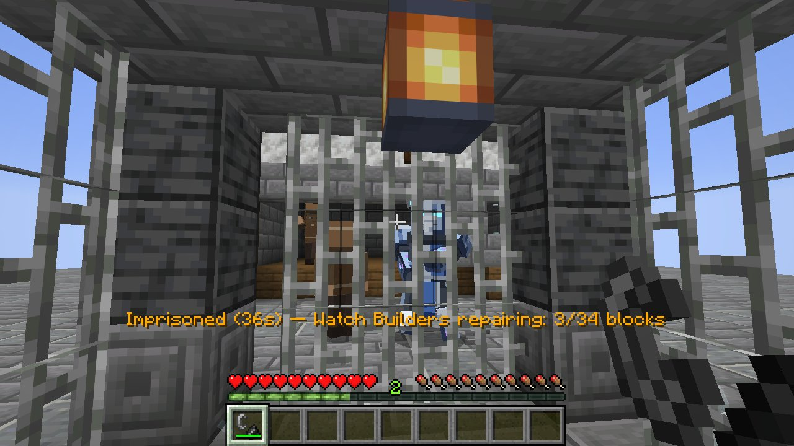
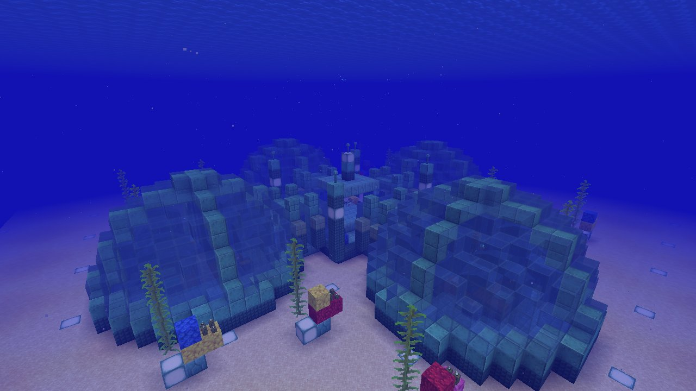
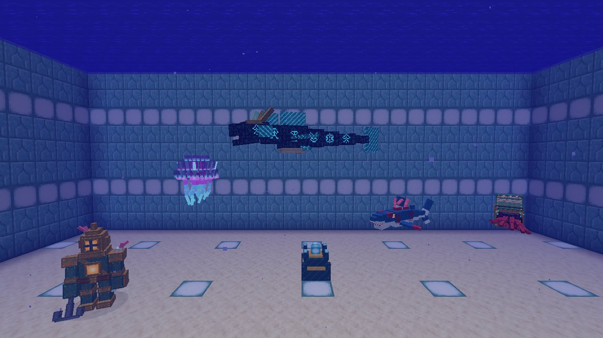
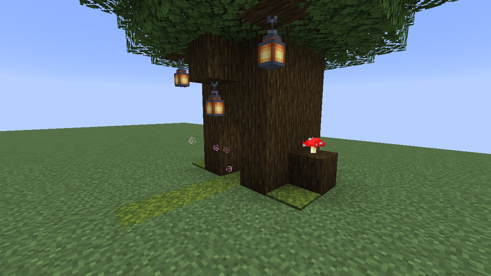
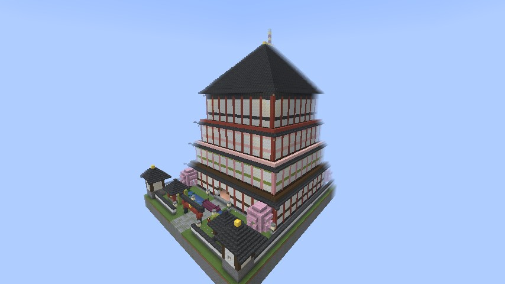
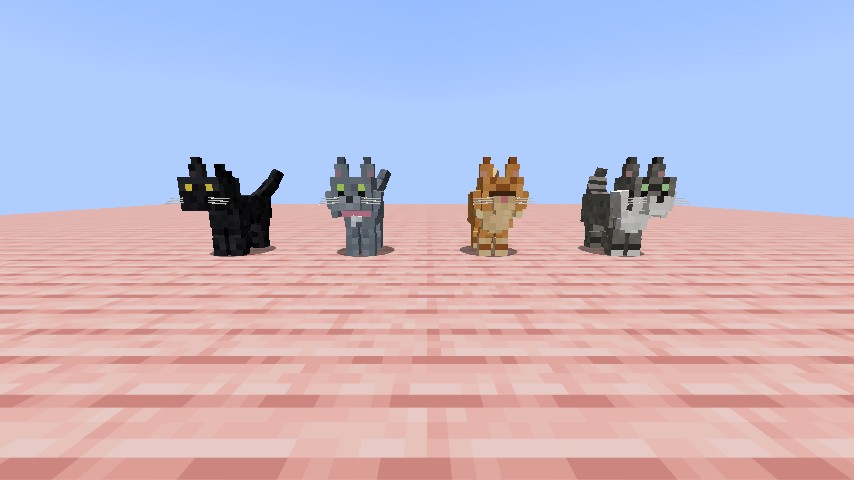

# What's new in 0.16.0: Sovereigns & Seas

Install `wildercord-0.16.0-alpha+mc26.3.jar` on the server and every client, with Fabric API 0.161.0+26.3 and Fabric Loader 0.19.5 or newer. This update adds entities, structures, items, blocks and packets, so **0.15.x clients must update before joining**. Back up your worlds first.

- **[Oathhold Sovereign Citadel City & Watch Stockade](world/oathhold.md)**: explore the `2,048×2,048` walled capital populated with 750+ citizens, `30` Rank `F–S` Adventurer's Guild requests (`/adventurer`), four articulated **Oathbound Champion Knights**, and live city justice where guards arrest house-breakers or TNT saboteurs into an iron-barred Watch Stockade while Master Builders reconstruct damaged structures block by block.

- **[Deep Ocean Expansion](world/deep-ocean.md)**: dive through 5 sunken landmarks (**Coral-Dome Sanctuary**, **Sunken Sovereign Galleon**, **Kelp-Spire Watchtower**, **Hydrothermal Vent Forge**, and **Abyssal Trench Citadel**); meet three **Brine-Merchant** professions; tame the **Pearl-Pup** and mountable **Lumi-Seahorse**; gather **Moon-Whale** ambergris; craft the 3D **Abyssal Diving Suit**, **Tide-Cleaver Harpoon**, **Leviathan Glaive**, and **Tidecaller Conch**; and fight **Thalassor, Abyssal Sovereign**.

- **[White Rabbit & Hollow Tree Portals](world/creatures.md#white-rabbit)**: follow rare pocket-watch White Rabbits in forest biomes to gnarled hollow trees with portals leading to a crystal cave, the **Wonderland Root-Vault**, or an all-bosses gauntlet.

- **[Cinnamon Upgrades](companions/cinnamon.md)**: Cinnamon heals injured owners and party members below 65% health, grows permanently to 3× size and strength with **Cinnamon's Grand Bow**, and carries up to 4 riders with shared 54-slot side chests, flight, and passive bolts using **Cinnamon's Flying Harness** (pausing 2–3s when hit).
- **Boss Survivability, Arena Respawns, Readable Fire FX & Structure Non-Overlap**: raised boss health pools (past the vanilla `1,024` HP cap), enabled arena boss respawns (`LairRespawns`), replaced obscuring custom-mob fire overlays with low perimeter embers (`CustomMobFireFx`), and added global `StructureClearance` checks across all 89 structure sets so buildings never spawn inside each other.

# What's new in 0.15.0: Shrine & Sakura

Install `wildercord-0.15.0-alpha+mc26.3.jar` on the server and every client, with Fabric API 0.161.0+26.3 and Fabric Loader 0.19.5 or newer. This update adds entities, structures, items and runes, so **0.14.x clients must update before joining**. Back up your worlds first.

- **Shrine Cats (`Yuki`, `Odie`, `Freya`, `Kuro`), Cat Sanctuary & Lantern Bathhouse**: conquer the four-tier Japanese **Cat Sanctuary** pagoda—facing hardened **Karakuri Sentinels**, hovering **Paper Lantern Spirits**, Floor Progression Seals, and Guardian Shrine Aegis—to unlock sanctuary buffs and tame all four unique cats with fish or a **Suzu Cat-Bell Charm**. Clear the steaming **Lantern Bathhouse** (`Fire + Wind` Rune Seal vault) for shrine treasures.

- **Four Sakura Village archetypes & six custom Sakura Villagers**: explore **Sakura Village** (tea house & Neko-Jinja shrine), **Sakura Canal Harbor** (sea-lantern canal, twin crimson bridges, watermill wheel & five-Torii hillside path), **Sakura Onsen Village** (two-story Ryokan Inn & steaming Rotenburo baths), and **Sakura Castle-Town** (Shirakabe walls, 3-tier Bell-Pagoda, Kendo Dojo & Katana Forge). Meet and trade with **Tea Masters**, **Shrine Maidens**, **Katana Swordsmiths**, **Lantern Artisans**, **Onsen Hostesses**, and **Koi Canal Fishermen**.

- **Ricochet, Suzu Chime, Ofuda Ward & block-variant crafting**: **Ricochet** now bounces up to 5 times solo (2 with Split, 15% decay); craft new runes **Suzu Chime** and **Ofuda Ward**; and craft **Blank Runes** and block recipes with cobbled deepslate, stone, wood and glass variants.
- **Mojito's Fetchblade & boss rewards**: Mojito now drops **Mojito's Fetchblade**, an Epic aura-forged greatsword with **Fetch Bound**; lair guardians, dungeon bosses, regional bosses, Sword Masters, giants, and the Archivist award scaled Aura Shards, Mana Crystals, Torn/Manual Pages, and runes, and Dungeon Relics restore mana and aura on a shorter cooldown.
- **3D weapon & staff models and Skyrend Glaive polearm combat**: forged weapons (`Oathkeeper`, `Lumenedge`, `Bulwark Maul`, `Skyrend Glaive`, `Fetchblade`) and all 20 elemental staffs have stepped 3D held models; `Skyrend Glaive` uses a two-handed cross-body guard stance and lever-action cleave.
- **Cooperative Ferryman**: the Reed-Crowned Ferryman now re-aims tells onto surviving challengers, marks two oarsmen with paired anchors in phase two, and shares extra Aura Shards among every contributor.
- **Tamed Coffer Mimics & Iron Golems**: iron golems leave tamed Coffer Mimics alone, and tamed mimics do not attack golems.
- **Dungeon wards & boss resets**: dungeon wards seal walls, decorations, and waterlogged blocks so survival players cannot tunnel into boss rooms or vaults; engaged dungeon bosses reset to full health if every challenger leaves or falls.
- **Parties, guilds & escorts**: an offline party leader automatically passes leadership after 3 days offline, `/guild` and `/coven` show how many members are online, and nearby party members earn a companion emerald share when an escort llama reaches its destination.
- **Master form default key**: the **Equipped Master form** key now defaults to `X` under **Wildercord: Master's Arts** (avoiding Creative's `C` Save Toolbar clash).
- **World & structure polish**: Shepherd's Steading, Tidepool Grotto, Granary Farmstead, Bell Chapel, Rune Library, Archive forecourt, Ember Sanctum cavern, and Belowkeeper Bell Sanctum's surface ruined belfry were rebuilt or expanded.

# What's new in 0.14.0: One road

Install `wildercord-0.14.0-alpha+mc26.3.jar` on the server and every client. This update adds an item, so it must match on both sides.

- **Four Lamps, One Road**: light all four regional lamps, then sneak-use each regional keeper again to finish a [journal](progression/lore-journal.md) lead that ends with a Lamplighter's Lantern.
- **Regional bounties**: gathering bounties can now ask for Moonreed Floss, Dried Glowcap Gills or Ember Tuft.
- **Caravans buy regional goods**: a wandering caravaneer pays an emerald each for Moonreed Floss, Dried Glowcap Gills and Ember Tuft, four at a time.
- **Put the Silk away**: press `G` (rebindable) or type `/silk` to stow Weaver's Silk so it stops catching you on walls while you jump; the same key brings it back. The choice survives death and relogs. See [Controls](controls.md).
- **Tame a coffer mimic** with books. A tamed mimic follows you, becomes a 27-slot chest only you can open, and can be petted by sneaking with an empty hand. See [Coffer Mimics](world/coffer-mimics.md).
- **Tame a thistle hedgehog** with sweet berries. It follows you, sits when told and brings you a forage find every few minutes. See [Creatures](world/creatures.md).
- **Bosses hit harder**: every boss's blows and projectiles land 35% harder, and at least 40% of what armour and Protection would stop goes through anyway.
- **Bosses move better**: richer warnings, strikes, follow-through and staged deaths, and a move used twice in a row now blends instead of snapping.
- **No more trees in boss lairs**: trees no longer grow inside or over overworld lairs and dungeons, and ones already there are cut down the first time the lair loads.
- **Grander buildings**: the dungeons and sites across the world were rebuilt bigger and richer, from the Ember Sanctum's crowned dome to the root temple's stepped pyramid, and forest sites now clear the trees over themselves. New versions appear in newly generated chunks.
- **Fixed**: a mount no longer crashes the server on its first ride after taming.

# What's new in 0.13.0: Living world

Install `wildercord-0.13.0-alpha+mc26.3.jar` on the server and every client, with Fabric API 0.161.0+26.3 and Fabric Loader 0.19.5 or newer. This update adds blocks, items, entities and packets, so **0.12.x clients must update before joining**. Back up your worlds first.

## New places to find

Each region has its own biome, a building, a resident, a lore route in your [journal](progression/lore-journal.md) and an optional boss.

- **[Luminous Reedlands](world/luminous-reedlands.md)**: pale banks and Moonreed pools, the Tideward Reedkeeper Landing, the Drowned Road and the [Reed-Crowned Ferryman](world/reed-crowned-ferryman.md) at the Last Crossing.
- **[Windscar Highlands](world/windscar-highlands.md)**: the Cairn Lodge and Cairn Keeper, the Paired Cairns and the [Glass Cartographer](world/glass-cartographer.md).
- **[Belowkeeper Hollows](world/belowkeeper-hollows.md)**: a Listening Station, its Listener, the Empty Bell route and the [Hollow Bell](world/hollow-bell.md).
- **[Emberwood Reach](world/emberwood-reach.md)**: a Charcoal Yard, its Kiln Keeper, the Eleven Winters route and the Kiln Widow.

## Also in this update

- Wider bounties and escort jobs, inn raids and rooms, hamlets and wandering caravans.
- Ritual spells and flawed runes.
- A spell-duel [arena](social/arena.md).
- Flying, water and burrowing mounts.
- [Guilds and covens](social/guilds.md) and co-op tribulations.
- Ascension past the Twentieth Circle, a codex bestiary and a [stats page](progression/stats.md).

This is an alpha. Report problems on the [issue tracker](https://github.com/defnotean/wildercord/issues/new/choose).

# What's new in 0.12.0: Tempering

Players were far too strong, so this update rebalances spell damage and defence. Circles and aura now take real effort, and the world fights back. Install `wildercord-0.12.0-alpha+mc26.3.jar` on the server and every client together: **0.11 clients must update before joining**. **Back up your world first.** Saves are re-tempered, so a heart or aura can settle a few circles or a stage lower. Condensed mana and aura experience are kept.

## Power, rebalanced

- **Spells hit for less**: less per hit, per cast and per point of mana, shared out past the third target, with bonuses capped at 3x against creatures. Spell power from circles is halved.
- **Defences don't stack into immunity**: lasting Resistance is capped at II, aura armour gives 15%, and boss and Master spells skip the spell guard. A duelist's blade guard takes only a quarter off a spell. Sword Masters erase every spell: only blade and aura reach them.

## The climb

- **About a hundred hours to circle 20.** Only a tenth of the mana you spend condenses straight away. The rest condenses only when your spells hurt hostile creatures, and spell farms mostly stop counting.
- **Aura stages take three times the experience.** Your aura now shows only while you're using it.
- **Tribulations.** The 5th, 10th, 15th and 20th circles have to be won against waves of tempered Runebound. Winning leaves runes, Mana Crystals and a **Tribulation Scar**: one more heart of health for good.
- **The breakthrough screen** shows what each circle gave you and what's next.

## Enemies

- **Tempered creatures** scale to the strongest player nearby.
- **Elites** come in five kinds: Swift, Ironhide, Vampiric, Brutal and Splitting.
- **Bosses** grow with every extra challenger and enrage at half health.
- Wildercord's monsters spawn twice as often, mostly in packs.
- **Frost and Ash** variants depend on where a creature is born.
- **Alpha** Gloomstalkers lead their packs.

## Cooking, mounts and the inn

- **Camp Pot**: set it over a fire and cook any of 21 meals from your pack. They give buffs such as Nourished (more max mana) and Focused (cheaper spells).
- **Ridgeback Stag**: the first mount, found on plains, meadows and savannas.
- **Black bobcat**: a rare, huge wildcat of dark forests that you tame with fish.
- **Wayfarer Inn**:
  - The bounty board offers one hunt a day for emeralds and reputation.
  - The Inn Cook, Stablemaster and Master's Emissary sell more as you go from Stranger to Known, Friend and Honoured.
  - The Stablemaster sells a Ridgeback Deed, and the Emissary sells a technique scroll.
  - The board and keepers appear only in inns generated on 0.12.

# What's new in 0.11.2

- **Worldgen crash fixed.** Exploring new land no longer crashes the server when a farm site, such as the walled orchard, generates with its sign.

Install `wildercord-0.11.2-alpha+mc26.3.jar` on the server and every client.

# What's new in 0.11.1

- **Cinnamon grows stronger when she's big.** While treats keep her full size she bites harder, has double health and armour, joins her owner's fights and casts fire, frost, lightning and arcane bolts, plus a healing beam when her owner is low. At normal size she is unchanged. See [Cinnamon](companions/cinnamon.md).
- **Screen fixes.** Tooltips in the Cord screen show again (badges, spell sockets and Codex runes). A Master study you can't read yet stays open and says what it needs. The Aura screen's header no longer prints text over the portrait or the Master's Arts help.

Install `wildercord-0.11.1-alpha+mc26.3.jar` on the server and every client.

# What's new in 0.11.0: Masters of Tomorrow

This update adds Sword Masters, new player sword arts and movement forms, 48 places to explore, a lore journal, a bigger magic climb, everyday runes and parties. Install `wildercord-0.11.0-alpha+mc26.3.jar` on the server and every client together: **0.10 clients must update before joining**. See [Installation and Updates](installing.md).

## Sword Masters

There are **16 Sword Masters**, one for each breathing method, and each offers an optional trial. Each Master fights with named techniques you can learn to read: clear warnings, counter windows, and a boss bar that names the move. Every school has its own signature moves, such as Ember's Cinder Wake and Kiln Ring, Gale's Crosswind Reprise, Stone's Fracture and Fault March, Echo's Tolling Bell, Dawn's Noon Glare and Venom's Serpent Coil. Your first clear of each Master teaches you a technique part.

See [Sword Masters](masters/index.md) and the [full technique list](masters/techniques.md): all 417 techniques. Each school has its own page:

[Crimson](masters/crimson.md), [Dawn](masters/dawn.md), [Dune](masters/dune.md), [Echo](masters/echo.md), [Ember](masters/ember.md), [Gale](masters/gale.md), [Hollow](masters/hollow.md), [Hourglass](masters/hourglass.md), [Iron](masters/iron.md), [Rime](masters/rime.md), [Starlit](masters/starlit.md), [Stone](masters/stone.md), [Thunder](masters/thunder.md), [Tide](masters/tide.md), [Venom](masters/venom.md) and [Verdant](masters/verdant.md).

## New breathing methods

Six new methods join the first ten, for 16 in all: **Tide**, **Iron**, **Dune**, **Echo**, **Dawn** and **Venom**. Each has its own element, gift and five arts. See [Breathing Methods](progression/breathing-methods.md).

## New sword arts

Three player arts: **Spellcut** (U), **Rising Break** (Y) and **Driving Cut** (J). Wandering Duelists also teach starter lessons: Echo, Afterimage and Sunder. See [Controls](controls.md) to rebind keys.

## Master forms and field forms

Equip one Master form and use it with **X**. The field forms move your real body, stop at walls and ledges and end in a short recovery: **Cinder Lunge**, **Reed Slip**, **Air Step**, **Plunging Strike**, **Wall Turn**, and **Stone Hinge** *(experimental; enabled via `aura.experimental_stone_hinge`)*. Masters and their teachers teach them. See [Master Forms](masters/master-forms.md).

**Spell Cut** is a learned swing that cuts a hostile spell bolt out of the air just as it reaches you. It needs no slot and no extra key. See [Spell Cut](masters/spell-cut.md).

## Combat presentation

An opt-in Articulated animation style for selected arts and Master attacks, plus a Stable camera that removes shake and bob. It only changes what you see. See [Combat Presentation](masters/combat-presentation.md).

## 48 new places to explore

Six families of buildings and places now appear in newly generated chunks, eight in each. Each has its own loot, advancement and page:

- [Farmsteads](world/farm-sites.md): a windmill, an herbalist's cottage, an apiary, a walled orchard, a shepherd's hut, a mushroom ring, a granary barn and a scarecrow field.
- [Master halls](world/masters-sites.md): eight halls and shrines for the breathing schools, each with practice dummies and a short trial.
- [Roadside places](world/travel-sites.md): an inn, a watchtower, a broken bridge, a rune library, standing stones, a caravan camp, a cartographer's hut and a vow circle.
- [Water places](world/water-sites.md): a stilt smokehouse, a lighthouse, a watermill, an ice fishing camp, a pier, a sunken shrine, net-weavers' huts and a tidepool grotto.
- [Mines and forges](world/mine-sites.md): a hillside mine, a forge hall, a crystal lab, a collapsed delve, a Nether foundry, a deepslate vault, a prospector's camp and a miner's rest.
- [Wild places](world/wilds-sites.md): a jungle ziggurat, a desert temple, a snowy monastery, a badlands gatehouse, a cherry-grove pavilion, a deep dark post, a Nether outpost and an End lantern.

Existing chunks don't change, so explore new land to find them.

## New weapons

The Oathkeeper, Bulwark Maul and Skyrend Glaive have new 3D models. See [Weapons](progression/weapons.md).

## More magic

- [Heart Circles](progression/heart-circles.md) now go up to Circle XX (was VIII).
- You can now use up to 100 [Mana Crystals](progression/mana.md#mana-crystals) (was 10).
- New lessons: [Relay Circle](spellcraft/relay-circle.md), [Reweave](spellcraft/reweave.md) through the Ebb Ledger, [Excise](spellcraft/excise.md), and the [Tollgate, Lifeline and Conduit](spellcraft/lesson-pack.md) lessons.

## Runes for everyday life and the Rune Catalog

There are now 756 runes, and many are for farming, fishing, mining, building, exploring and helping others, not only fighting. To find one, open the **Rune Catalog** with `Ctrl`+`B` or the **Catalog** link on the Cord screen. You can search, filter by family, element and use, and see which runes **go well with** the one you picked. See [Rune Catalog](spellcraft/rune-catalog.md).

Nearly 300 of the new runes come in everyday packs: hearth, Tide, farmstead, delving, Wayfarer's and support. None of them deals damage. See [Everyday Rune Packs](runes/everyday-packs.md).

## Lore journal

Press **H** to open your lore journal. It records the places you find, the duelists and Masters you meet, what you learn and what they say to you, and it gives you six **leads** to follow, each with a reward. See [Lore Journal](progression/lore-journal.md).

## Circle Vows

Seven of the new Heart Circles (IX, XI, XIII, XV, XVII, XIX and XX) ask you to choose one of two vows, such as more mana or faster mana. Type `/vow` to see them and `/vow take <vow>` to choose. Changing your mind costs 5 levels. See [Circle Vows](progression/circle-vows.md).

## Parties

Group up with `/party invite <player>` for up to 8 players. The other player clicks **[Accept]**, or types `/party accept <your name>`. Party members can't hurt each other, and your helpful spells reach them. Invites expire after 60 seconds, and parties end when the server restarts. See [Parties](social/parties.md).

## For server owners

Back up worlds and the `config` folder before updating. Existing chunks don't change. Operators can place a few small encounters, such as a Wayfarer Training Pavilion, in old terrain with `/wildercord-upgrade`, which shows a preview first and can be rolled back. See [Pavilion Upgrade for Old Worlds](world/pavilion-upgrade.md).

## Fixes

- Delayed effects remember who cast them and check who is an ally when they land.
- Interrupting a spell, by a Master or with Driving Cut, now needs damage that actually lands. A full guard or a dodge keeps your cast.
- Lantern Newts no longer drift upward in tight turns, and rimehares settle at the end of a route.
- Villagers at water sites stay home as residents, so they're never mistaken for wanderers.
- Hailfall stops hitting and chilling once it has ended.
- Glimmerwings find the lantern light around them and follow it.

Older releases: see the [full changelog](https://github.com/defnotean/wildercord/blob/main/CHANGELOG.md).
