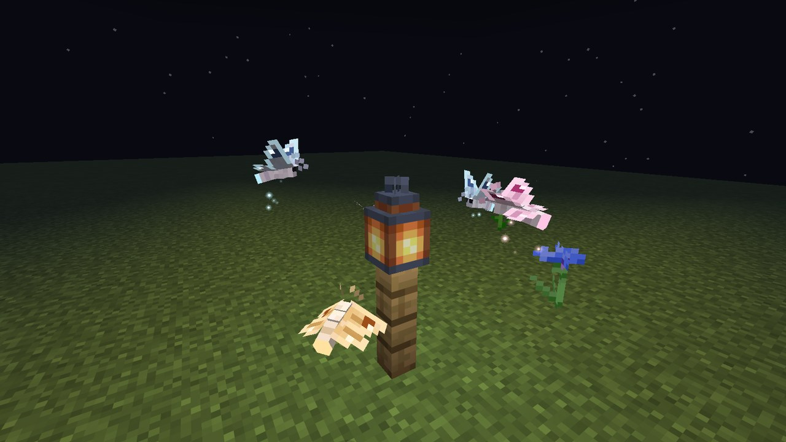
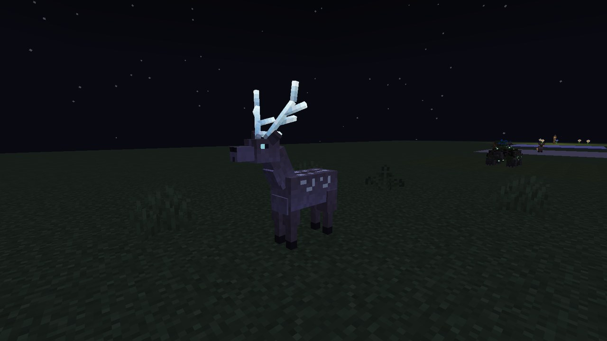
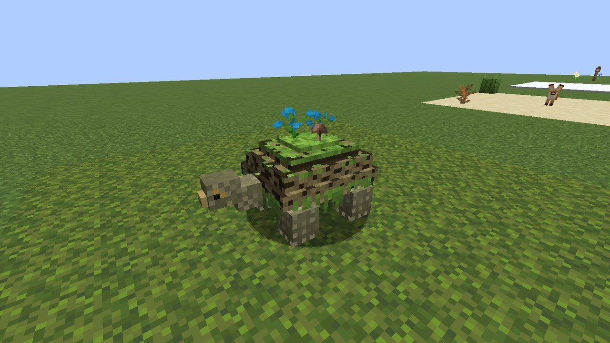
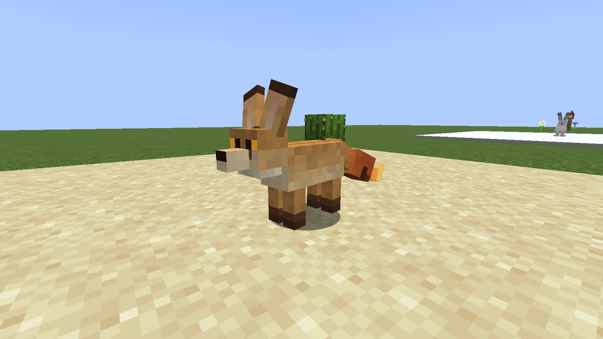
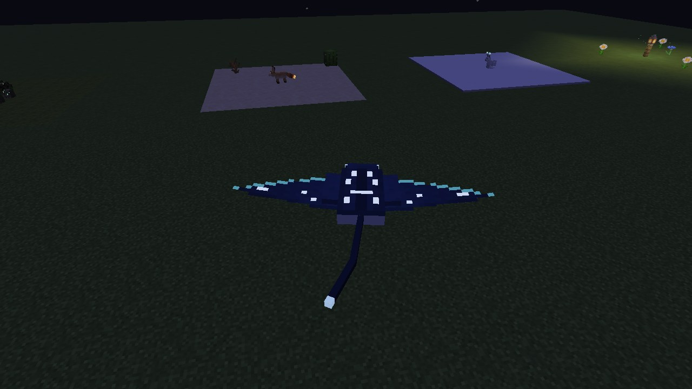
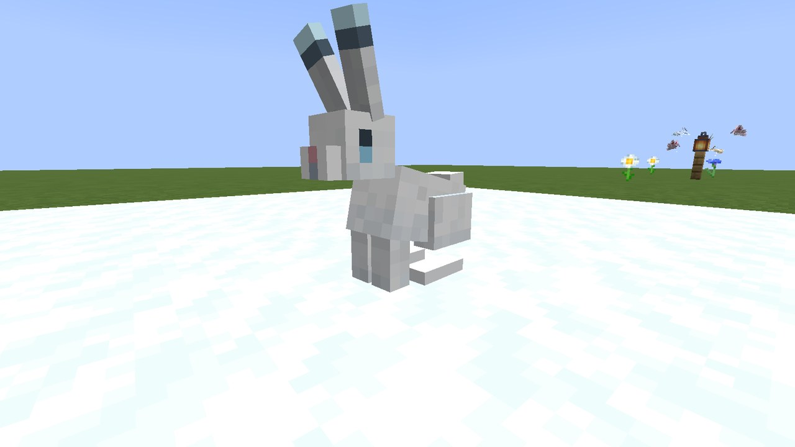
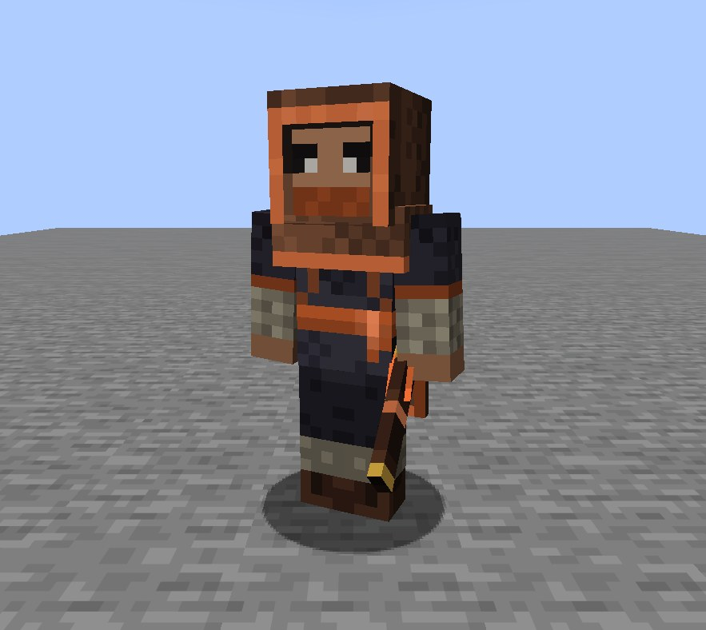
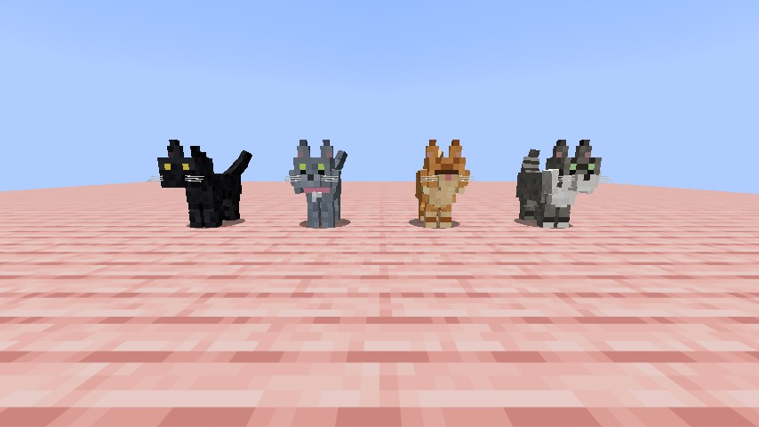
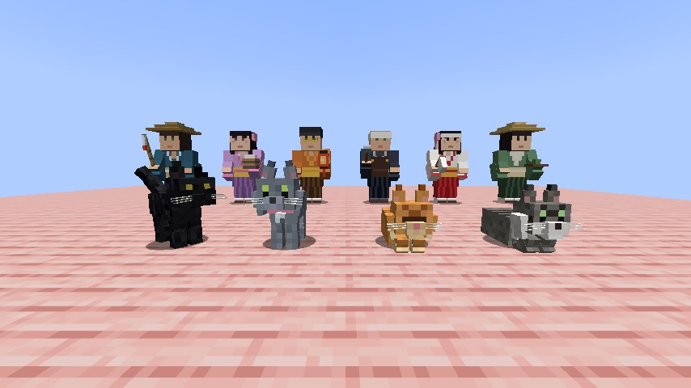

# Creatures

## What it is

Six magical creatures live in the world's forests, swamps, deserts, mountains and snowfields. None of them attack you.
Each leaves behind something useful. You'll also meet the odd **wandering duelist**, who teaches its breathing method
to anyone who beats it.

The first time you see a creature up close, it goes into your **Grimoire** with a short entry and a little mana toward
your next Heart Circle. Creatures you haven't met are listed too, as a hint.

For wetland, cave and highland wildlife, see [Lights Along the Bank](luminous-wetlands.md),
[Mossveil Dormice](mossveil-dormice.md),
[Reedback Crabs](reedback-crabs.md),
[Rootmolt Striders](rootmolt-striders.md),
[Siltcrest Bittern](siltcrest-bittern.md) and
[Sporeback Snails](sporeback-snails.md).

## At a glance

| Creature | Where | How common | Leaves | Good for |
|---|---|---|---|---|
| [Glimmerwing](#glimmerwing) | Forests, flower and birch forests, dark forests, meadows, sunflower plains, cherry groves, swamps (at night) | Swarms of 3 to 5 | Glimmer Dust | Night Vision potions, glow ink sacs |
| [Lumen Stag](#lumen-stag) | Old-growth birch, pine and spruce forests, taigas, cherry groves | Rare, alone | Lumen Antler | Mana Crystals |
| [Mossback Tortoise](#mossback-tortoise) | Swamps, mangrove swamps, jungles | 1 or 2 | Mossback Scute | Turtle Master potions, mending turtle shells |
| [Cinderfox](#cinderfox) | Deserts and badlands | 1 to 3 | Ember Tuft | Fire Resistance potions, furnace fuel |
| [Skyray](#skyray) | Windswept hills and forests, meadows, peaks, snowy slopes | Very rare, high up | Skyray Membrane | Slow Falling potions, mending elytra |
| [Rimehare](#rimehare) | Snowy plains and taigas, ice spikes, snowy slopes, groves | 2 or 3 | Rime Fur | Rimebound armour, leather |
| [Wandering Duelist](#wandering-duelist) | Near villages and roads, by day | Rare | Its breathing method | Learning aura |
| [Black Bobcat](#black-bobcat) | Dark forests, old taigas | Rare | Fight beside you | Feeding fish tames it |
| [Shrine Cats](#shrine-cats) | Cat Sanctuary, Sakura Villages | 4 unique guardians (`Yuki`, `Odie`, `Freya`, `Kuro`) | Sanctuary buffs & unique companion powers | Yield on Sanctuary floors, then tame with fish or Suzu Cat-Bell Charm |
| [Sakura Villagers](#sakura-villagers) | Cat Sanctuary, Sakura Villages | 2 to 4 per village | Suzu Cat-Bell Charms, Blank Runes, lanterns, golden carrots, salmon | Use an emerald to trade |
| [Thistle Hedgehog](#thistle-hedgehog) | Meadows, plains and forests | 1 to 3 | Nothing; brings you finds | A tameable pet that forages for you |
| [White Rabbit](#white-rabbit) | Forests, birch forests, dark forests, taigas, cherry groves | Rare, alone | Leads you to a Hollow Ancient Tree | Step into its portal for a cave, treasure vault, or all bosses at once |

Glimmer Dust, Mossback Scutes, Ember Tufts and Skyray Membranes each brew their potion from an Awkward Potion.

## Glimmerwing

Glimmerwings circling a lantern at night.

Glowing moths that come out at night and fade away at dawn.

- **They go to light.** Lanterns, torches and campfires draw them. So does casting a spell near them.
- **Each swarm has a colour:** blue in most woods, rose in flower forests and cherry groves, amber in meadows.
- **One hit** and a glimmerwing is gone, leaving **Glimmer Dust**.

**Glimmer Dust** brews **Night Vision**. With an ink sac it makes a **glow ink sac**.

## Lumen Stag

A lumen stag's antlers glow brightest under a full moon.

A rare, shy deer with crystal antlers that glow with the moon.

- **It bolts** if you walk or run at it.
- **Sneak up slowly** and it watches you. Stand still beside it for a few seconds and it trusts you, shedding a
  **Lumen Antler** at your feet. A stag sheds one antler a day.
- **Never harm one.** A slain stag drops nothing, and its killer gets **Bad Luck** for 5 minutes. Nearby stags stop
  trusting anyone for a long while.

A **Lumen Antler** can replace the diamond in a **Mana Crystal** recipe.

## Mossback Tortoise

A mossback tortoise with its swamp garden.

A huge, slow tortoise with a little garden on its shell that matches where it lives (swamp, mangrove or jungle).

- **It hides when struck,** taking much less damage for a few seconds.
- **It loves melon.** Hold a melon slice and it follows you. Feed two to breed them.
- **It sheds a Mossback Scute** every 10 to 20 minutes. A baby leaves one as it grows up.

A **Mossback Scute** brews **the Turtle Master** and mends a turtle shell at an anvil.

## Cinderfox

A cinderfox in the desert.

A big-eared desert fox whose tail ends in a living ember.

- **Taming:** feed it rabbit or fish. Each try has a 1 in 3 chance.
- **A tame cinderfox** follows you, sits when you use it with an empty hand, and fights what you fight. Heal it with
  rabbit, chicken or fish. Feed two tame ones to breed them.
- **Its bite** sets fire-weak creatures alight and hurts them extra. Fire and lava can't harm it.
- **Brush it** once a day for an **Ember Tuft**.

An **Ember Tuft** brews **Fire Resistance** and smelts eight items as furnace fuel.

## Skyray

A skyray's back at night.

A great sky manta that glides in wide loops high over mountains and meadows. You'll often hear its song before you see
it.

- **It sheds membranes** now and then, which drift down while someone is nearby.
- **Harm one** and it climbs away. A slain skyray drops a membrane or two.

A **Skyray Membrane** brews **Slow Falling** and mends an **elytra** like a phantom membrane.

## Rimehare

A rimehare on the snow.

A fast white hare that leaves fading frost prints.

- **Hard to catch.** It flees faster than you can sprint. Hold **sweet berries** and stand still, and it hops up to you.
  Move or turn your head and it bolts.
- **Breed** two with sweet berries.

**Rime Fur** can replace packed ice in **Rimebound armour**. Four Rime Fur make a piece of **leather**.

## Wandering Duelist

A duelist who breathes Ember Breath.

A hooded sword master who breathes one [breathing method](../progression/breathing-methods.md). Its
cloak trim, sash and mask show which.

- **Where:** by day, near a village bell, along a road, or out in the open by a small campfire. It moves on after a
  while.
- **It's harmless,** and turns aside any blow unless you're duelling it.
- **To duel:** use it with a blade in hand, then use it again within 10 seconds to accept. Beat it and it teaches you its
  method. See [Duels with a duelist](../progression/aura.md#duels-with-a-duelist).

- **To call its Master:** once you've reached Aura Form or Heart Circle VIII, sneak and use the duelist, then do it
  again within 10 seconds. You can also type `/master challenge <school>`.

For the stronger teachers, see [Sword Masters](../masters/index.md). The eight
[Master halls](masters-sites.md) are good places to train first.

## Ridgeback Stag

The first mount: a broad chestnut stag with a dark ridge of mane, on plains, meadows and savannas. Climb on until it
stops throwing you, as with a horse, then saddle it. It is sturdier and quicker than most horses (24 to 32 health) with
a better jump. It eats wheat, apples, carrots and hay; two tame stags fed golden apples or golden carrots raise a calf.
A Wayfarer Inn’s stablemaster sells deeds to tame ones.

## Black Bobcat

A rare melanistic wildcat of dark forests and old taigas, as big as a polar bear. A wild one keeps to itself and turns
on whatever hurts it. Offer it fish, raw or cooked: one time in three it becomes yours. A tame bobcat follows, sits when
told, joins your fights and heals on fish; two fed fish raise a kitten. Toggle it with `creatures.black_bobcat`.
Its kin, the Frost Lynx and the Dune Cougar, each have a perk of their own: see [Tameable Predators](tameable-predators.md).

## Thistle Hedgehog

A small round forager with cream-tipped quills, snuffling through the grass of meadows, plains and forests. Run at it,
let something hostile near or hit it and it curls into a ball: curled, it takes little damage and pricks back whatever
struck it. It peeks out after a few seconds, then uncurls.

- **Trust:** feed it **sweet berries** and it trusts you for two minutes. It follows you, ignores your running and
  often brings you something it found: berries, a mushroom, a dandelion, an apple or seeds.
- **Taming:** each handful of sweet berries also has a 1 in 3 chance to tame it for good (hearts).
- **A tame hedgehog** follows you, turns up beside you if you get far ahead, and never curls up at you. Use it with
  anything but berries to make it sit (it half curls and peeks out), and again to make it follow. Berries heal it
  while it's hurt. Every few minutes it brings you another find.
- Two tame hedgehogs fed berries raise a hoglet that is yours too.

## Shrine Cats

From left to right: Kuro, Freya, Odie, and Yuki.

Four custom-modeled guardian cats preside over the **Cat Sanctuary** pagoda and stroll peacefully through the four **Sakura Villages**:

- **Yuki** (Floor 1, fluffy charcoal-and-cream longhair with whiskers): yields non-lethally to grant **Whisker Ward** (`Resistance I`), and when tamed bolsters nearby combat defence and leaps on foes.
- **Odie** (Floor 2, sleepy longhair orange tabby who loafs beside kotatsu hearths): grants **Sunbeam Loaf** (`Regeneration I + Fire Resistance`), and when tamed warms and regenerates nearby owners.
- **Freya** (Floor 3, plush grey shorthair with rose-pink collar and swinging silver Suzu bell): grants **Silver-Bell Chime** (`Absorption I + Haste I`), and when tamed boosts attack/casting tempo and chimes near allies.
- **Kuro** (Floor 4 roof master, notched left ear & golden eyes): grants **Night-Stalker Grace** (`Speed II, Strength I, Night Vision`) and unlocks taming for all four cats!

Tame any cleared quartet cat with cooked salmon/cod or a **Suzu Cat-Bell Charm** (which also rings to call following cats back, unseat resting cats when sneaking, and summon back a fallen companion without ever duplicating sitting or distant cats). Sneak-click a tamed cat to toggle between loafing/sitting and following; tamed quartet cats never permanently die to owner hits, thorns, or dungeon hazards.

## Sakura Villagers

All six Sakura Villager professions in their traditional garb.

Six peaceful kimono-clad NPCs bow when greeted and trade role supplies for a single emerald:

| Profession | Attire & Craft | Emerald Trade |
|---|---|---|
| **Sakura Tea Master** | Sage hakama, woven *amigasa* hat, lacquered tea tray | `1x Suzu Cat-Bell Charm` |
| **Sakura Shrine Maiden** | Crimson & white *miko* garb, pink *kanzashi*, *gohei* wand | `4x Cooked Salmon` |
| **Sakura Swordsmith** | Charcoal *samue*, riveted leather apron, *hachimaki* headband, iron hammer | `4x Blank Rune` |
| **Sakura Lantern Artisan** | Vermilion kimono, flat cap, brass spectacles, glowing dangling *chochin* pole | `4x Lantern` |
| **Sakura Onsen Hostess** | Wisteria-blush *yukata*, gold obi bow, cedar towel bucket | `3x Golden Carrot` |
| **Sakura Koi Fisherman** | Indigo wave-hem *happi*, weathered *kasa* hat, creel basket, bamboo rod | `4x Raw Salmon` |

## White Rabbit

A snowy white rabbit wearing a crimson collar ribbon and a brass pocket watch spawns rarely inside forest biomes (oak, birch, flower, dark, taiga, and cherry groves).

- **Follow the trail.** Come near one and it checks its watch, chimes softly, and bounds ahead along an enchanted trail, pausing to wait if you fall too far behind.
- **Hollow Ancient Tree.** At the end of its run sits a gnarled oak tree whose open doorway conceals a swirling **Rabbit-Hole Portal**. Once you catch up, the rabbit leaps straight down the burrow.
- **Three Possible Fates.** Step into (or interact with) the dark portal inside the roots to tumble into one of three random destinations — each equipped with a **Return Burrow Portal** back to the woods:
  1. **Random Underground Cavern:** drops you into a quiet crystal-and-ore cave deep beneath the earth.
  2. **Wonderland Root-Vault:** a lantern-lit treasury packed with chests holding emeralds, diamonds, Mana Crystals, Aura Shards, and Torn Pages.
  3. **All Bosses at Once:** a sunken deepslate colosseum where all **17 Wildercord bosses** awaken together in one colossal battle!

## Camp cooking

Craft a **Camp Pot** and set it over a lit campfire, fire, magma or lava. Use a bowl on it to cook from what you carry:
the meal you picked, or the richest you can make. Click with an empty hand to read the cookbook, and sneak-click to pick
the next meal. 21 meals, from Hearty Stew to the Archmage’s Feast, feed well and carry buffs: **Nourished** (+20 max
mana a level), **Focused** (8% off every spell a level, up to two), **Clarity** and vanilla effects. None adds damage.

## Tips and counterplay

- Every creature has a spawn egg in creative mode.
- Natural spawns follow the usual animal limits, and rare creatures keep apart.
- Server owners can switch creatures off, or make them rarer or more common.
