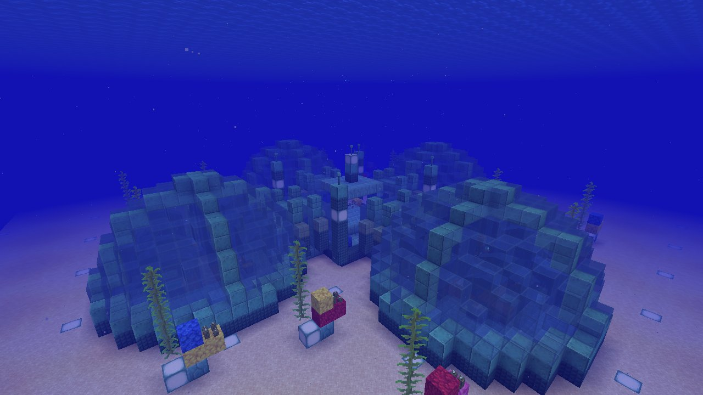
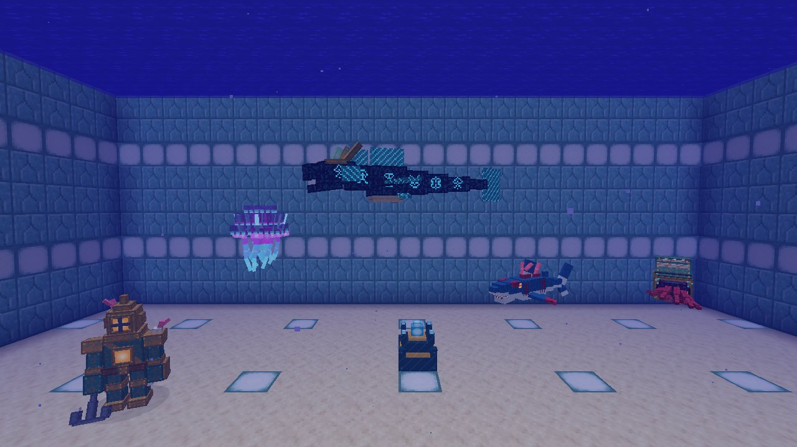
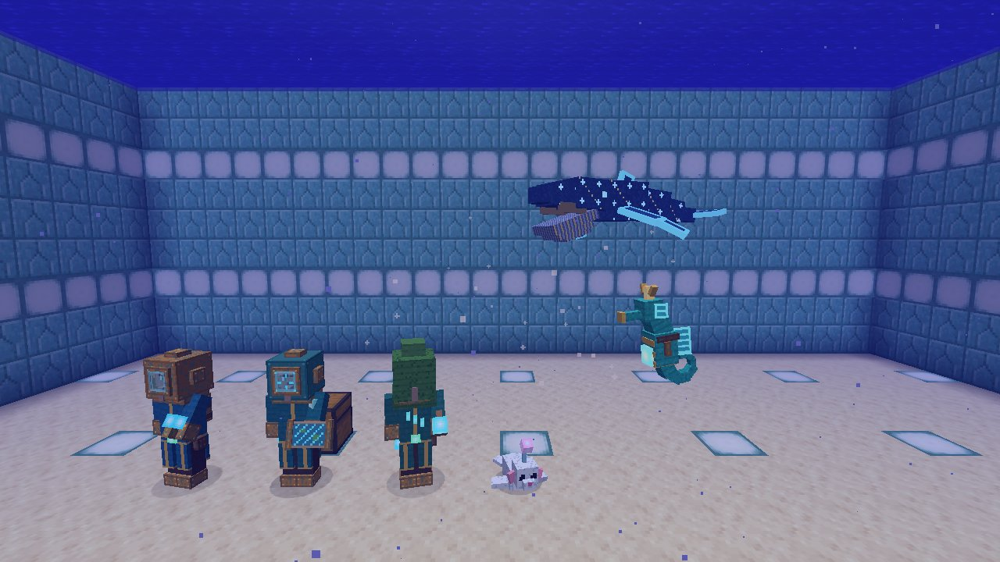
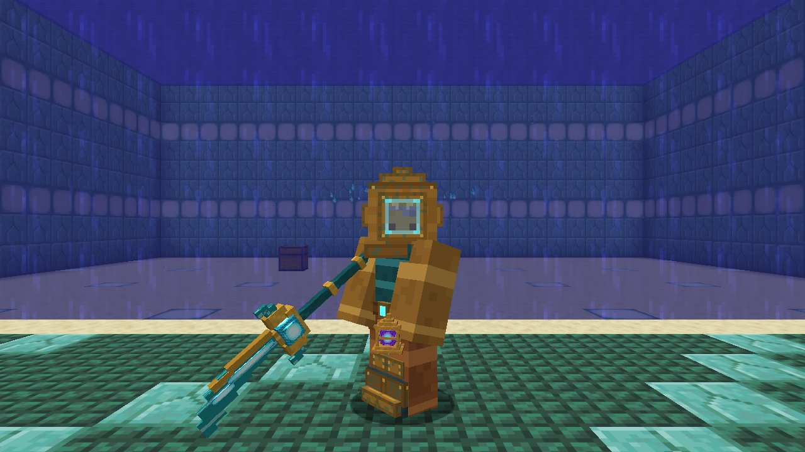
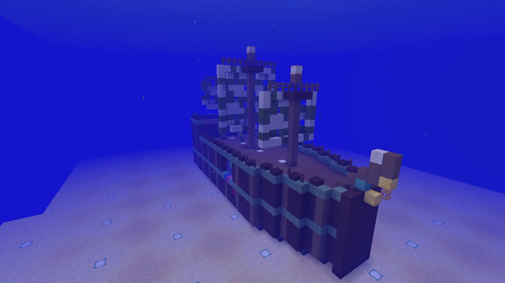
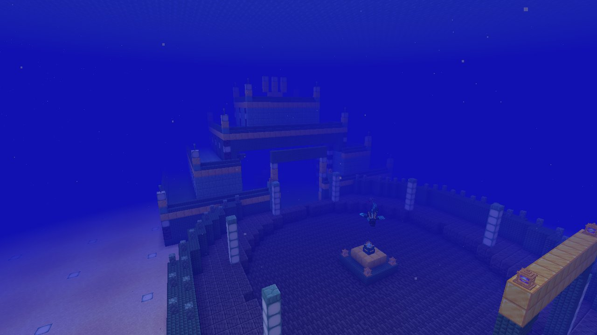

# Deep Ocean Expansion

Beyond shallow coastal reefs lie pressurized ocean depths teeming with sunken warships, Tidefolk coral settlements, hydrothermal smithies, singing leviathans, and the ruined citadel of **Thalassor, Abyssal Sovereign**.

A Coral-Dome Tidefolk Sanctuary glowing across the sea floor.

## Creatures of the Deep

### Enemies & Boss

Thalassor, Abyssal Sovereign, with deep-sea raiders and sentinels.

If set alight underwater or on land, custom ocean monsters shed low perimeter embers rather than view-blocking body flames so every tentacle and fin stays readable in combat.

| Creature | Habitat | Health | Key Traits & Drops |
|---|---|---|---|
| **Barnacle-Hulk Dredger** | Deep oceans, Galleons, Vent Forges | 110 HP | Corroded coral-encrusted diver with chained Anchor-Flail overhead slam & pull; drops *Abyssal Iron Plate* & *Coral-Edge Fang* |
| **Siren-Veil Jelly** | Open oceans & deep basins | 44 HP | Translucent violet medusa firing stinging voltaic shock rings; drops *Voltaic Jelly Sac* |
| **Coral-Spine Mako** | Open & deep oceans, Galleons | 56 HP | High-speed shark with coral dorsal spines that snaps & torpedo-lunges; drops *Coral-Edge Fang* |
| **Dread-Nautilus Sentinel** | Deep oceans, Citadel perimeter | 85 HP | Coiled bronze sentinel deflecting non-frontal hits before firing cyan focal beams; drops *Nautilus Shell* & *Abyssal Pearl* |
| **Thalassor, Abyssal Sovereign** *(Boss)* | Abyssal Trench Citadel Colosseum | 2,400 HP | 14-segment serpentine boss with 3 phases, maelstrom pulls, escort summons, and swept hydro-beams; drops *Leviathan Heart-Pearl* & *Abyssal Pearl* |

### Friendlies, Mounts & Companions

Singing Moon-Whale alongside Tidefolk Brine-Merchants, Pearl-Pup and Lumi-Seahorse.

- **Tidefolk Brine-Merchants** (`Pearl Jeweler`, `Abyssal Cartographer`, `Kelp Alchemist`): live in the dry domes of Coral-Dome Sanctuaries and trade pearls, Lanterns, Conches, sea cuisine, and building stone.
- **Lumi-Seahorse** *(Mount)*: tame with kelp, seagrass, or cod and fit with a saddle for full 3D yaw+pitch underwater riding and jump-triggered Fin-Burst dashes.
- **Pearl-Pup** *(Companion)*: tame with cod, salmon, or Kelp-Wrapped Sashimi; swims beside you, waddles through sanctuaries, and illuminates its forehead lure while sniffing out sunken treasure chests.
- **Singing Moon-Whale** *(Peaceful Leviathan)*: 220 HP titan whose harmonic chords grant *Water Breathing*, *Dolphin's Grace*, and *Regeneration*, shedding *Star-Barnacle Ambergris* when fed fish or kelp.

## Diving Suit, Relics & Sea Cuisine

The 3D Abyssal Diving Suit, Trench Anvil, Siren-Pearl Lantern and abyssal arms.

- **Abyssal Diving Suit** (`Abyssal Diving Helm`, `Bathysphere Chestplate`, `Kelp-Weave Greaves`, `Trench Boots`): worn with 3D front cyan porthole & twin back brass oxygen tanks; grants pressurized tank breathing underwater, Night Vision, faster underwater movement/mining, and Conduit Power + 25% abyssal damage mitigation when wearing all four pieces.
- **Tide-Cleaver Harpoon**: thrown harpoon dealing bonus damage to submerged targets, reeling enemies back toward you, or anchoring into solid blocks to zip yourself across underwater canyons when holding sneak.
- **Leviathan Glaive**: polearm with `+1.25` extended reach; right-click unleashes an arcing 75-degree *Hydro-Slash* wave.
- **Siren-Pearl Lantern**: placeable light-15 underwater brass cage or offhand relic pushing back minor swarmers and granting underwater clarity.
- **Tidecaller Conch**: blows a 4.5-block breathable Air Dome around the caster for 12 seconds.
- **Kelp-Wrapped Sashimi & Sea-Salt Ramen**: seafood dishes restoring hunger while granting *Conduit Power*, *Dolphin's Grace*, *Water Breathing*, and *Regeneration II*.

## Five Sunken Landmarks

All five ocean structures obey global non-overlapping `StructureClearance` spacing so reefs, wrecks, watchtowers and citadels never intersect one another or neighboring sites.

The Sunken Sovereign Galleon resting in deep ocean waters.

1. **Coral-Dome Tidefolk Sanctuary** (`49×18×49`): Four dry cyan-glass geodesic domes linked by copper-ribbed tunnels around an active Conduit Plaza, sheltering all three Brine-Merchant professions and Pearl-Pups.
2. **Sunken Sovereign Galleon** (`46×28×15`): Three-deck warship complete with bilge cargo hold, gun deck cannons, tattered moss sails, Stern Captain's Cabin, and patrolling Dredgers.
3. **Kelp-Spire Watchtower** (`15×H×15`): Dry seabed diving-bell station joined by twin `soul_sand` (UP) and `magma_block` (DOWN) glass bubble-elevator shafts to a surface boat dock and Beacon Crown.
4. **Hydrothermal Vent Forge** (`27×20×27`): Basalt chimneys and seafloor magma fissures piping heat into a dry glass foundry dome housing the **Trench Anvil** (crafts and repairs Abyssal Diving gear and weapons).
5. **Abyssal Trench Citadel** (`65×28×65`): Stepped dark-prismarine & gold Temple Ziggurat and Inner Sovereign Sanctum opening onto an 8-obelisk Boss Colosseum centered on the **Sovereign Awakening Altar**, where Thalassor fights and periodically respawns.

The Abyssal Trench Citadel and Sovereign Awakening Colosseum.
