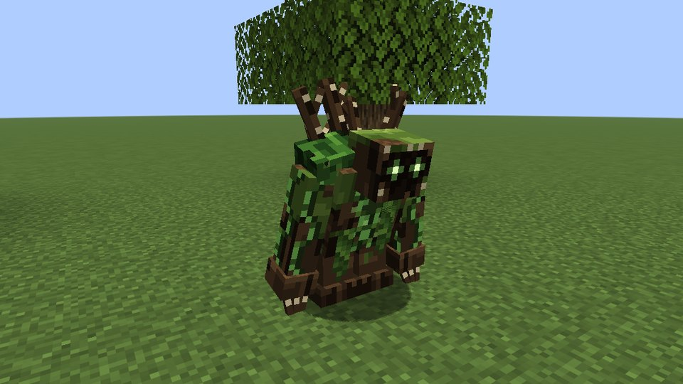
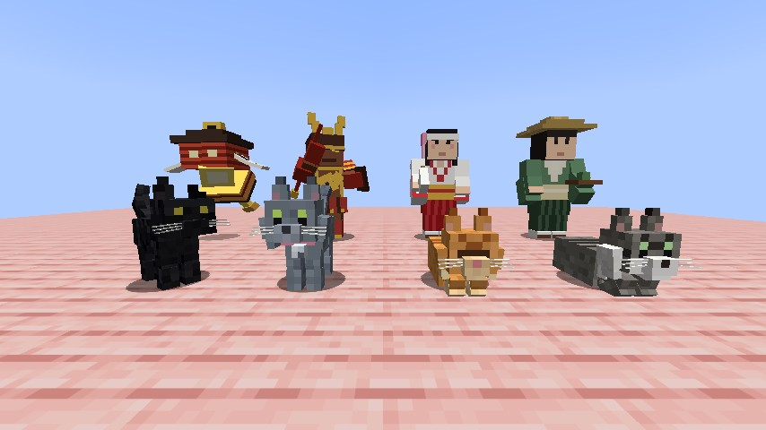
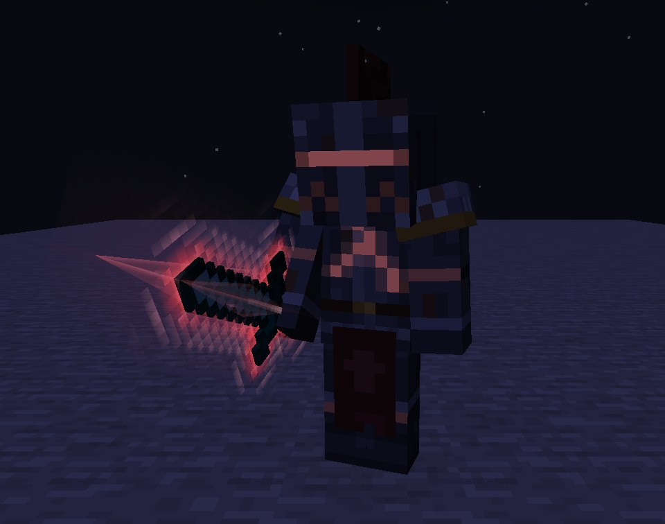

# Monsters of the Wilds

A Bramblewalker at the edge of the woods.

## What it is

Six magical monsters live beside the zombies and skeletons, and **fallen knights** walk the deep old places. Each has a
**tell** before its big attack and a **way to beat it**. None appear on Peaceful, and they're never common.

| Monster | Where | Watch for | Beat it with | Drops |
|---|---|---|---|---|
| [Bramblewalker](#bramblewalker) | Forests at night | It rears back, vines glowing | Fire; step aside | Living Bramble |
| [Gloomstalker](#gloomstalker) | Dark forests at night, deep caves | Violet eyes flare before a pounce | Light | Shadow Pelt |
| [Thunderwing Harpy](#thunderwing-harpy) | High peaks and windswept hills | A shriek, wings flung wide | Dodge the dive; earth spells | Storm Feathers |
| [Geode Crawler](#geode-crawler) | Caves, near amethyst geodes | It curls up and rattles | Mace, pickaxe, blasts, storm | Geode Grit, amethyst |
| [Bog Witch-Frog](#bog-witch-frog) | Swamps at night | Its throat swells and glows | Pop the bubble; raise a shield | Bog Gland |
| [Mana Ooze](#mana-ooze) | Deep caves, caves under ley lines | It drinks spells and swells | Blades, arrows, fire | Mana Gel |
| [Karakuri Sentinel](#karakuri-sentinel) | Cat Sanctuary, Lantern Bathhouse | Brass chest gears spin & it winds back a naginata lunge | Heavy strikes, lightning or fire; stagger between swings | Gold Nuggets |
| [Paper Lantern Spirit](#paper-lantern-spirit) | Cat Sanctuary, Lantern Bathhouse | It unhinges its ember jaw and charges a flame burst | Shoot before detonation or dodge the flame pulse | Lanterns |
| [Fallen Knight](#fallen-knight) | Strongholds, ancient cities, expeditions, dungeons | Blade raised, a line of light on the ground | Step off the line; break its guard with an axe | Manual Pages, Aura Shards |
| [Oathbound Bastion](#oathbound-bastion) | Deep haunts (strongholds, ancient cities, expeditions) | Hexagonal shield barrier, overhead mace windup | Shatter guard with an axe; bait Shield-Ram into walls; clear shockwave ring | Iron/Stone Manual Pages, 2–3 Aura Shards, Gold, Iron, Diamonds |
| [Oathbound Blade-Champion](#oathbound-blade-champion) | Deep haunts (strongholds, ancient cities, expeditions) | Two-handed diagonal blade parry, forward pommel lunge, overhead Zweihänder arch | Smash Wrathful Riposte with an axe; dodge the shield-shattering Pommel-Break Lunge; sidestep the Guillotine fissure | Crimson/Ember Manual Pages, 2–4 Aura Shards, Gold, Iron, Diamonds |
| [Oathbound Halberdier](#oathbound-halberdier) | Deep haunts (strongholds, ancient cities, expeditions) | Sweeping cyan storm coil, blink-thrust crouch, overhead halberd arch | Sidestep the 4-way Thunderbolt cross; interrupt halberd windups with an axe | Thunder/Gale Manual Pages, 2–4 Aura Shards, Iron, Gold, Diamonds |
| [Oathbound Banner-Marshal](#oathbound-banner-marshal) | Deep haunts (strongholds, ancient cities, expeditions) | Skyward sword & blazing banner ring, chest Sun-Shield lock, overhead command arch | Smash Solar Aegis with an axe; focus down first to stop rally heals; step out of Sovereign Judgment pillars | Dawn/Hourglass Manual Pages, 3–4 Aura Shards, Gold, Emeralds, Diamonds |

Any of the six can also be [Runebound](runebound.md). Their magic counts as spells, so
armour, Warding and the spellguard all help. Your Grimoire's Bestiary fills in each one's
[affinities](../spellcraft/affinities.md) as you strike them. Each has a spawn egg in creative mode.

## Bramblewalker

A hunched, walking thicket. Found on forest floors at night, most of all in dark forests and the pale garden.

- **Its lash:** it rears back with glowing vines, then whips a vine at where you stood. If it hits, you're **rooted**
  for a moment.
- **Beat it:** step aside as it rears. Fire hurts it extra, and while burning it panics and runs.
- **Affinities:** weak to fire; resists earth and life.
- **Drops:** **Living Bramble**. Throw it to root whatever it hits for two seconds.

## Gloomstalker

A shadow panther, nearly invisible in the dark except for two violet eyes. Found in dark forests and the pale garden at
night, and in deep caves below height 0.

- **Its pounce:** it circles unseen, crouches (its eyes flare), pounces, then slinks off to try again. A missed pounce
  leaves it sprawled for a moment.
- **Beat it with light.** It can't hide in torchlight or daylight, right next to you, while glowing, for 6 seconds after
  a fire, storm, arcane or life spell hits it, or for 2 seconds after any wound.
- **Affinities:** weak to arcane; resists void.
- **Drops:** a **Shadow Pelt**. Brew it into an Awkward Potion for **Invisibility**.

## Thunderwing Harpy

A storm-blue hunter of the bare peaks and windswept hills, from about height 90 up, at night or in a thunderstorm.

- **Its dive:** it circles high, shrieks with wings wide, then dives at you. In a thunderstorm it also marks a yellow
  ring under you, and lightning strikes there.
- **Beat it:** dodge the dive. A miss leaves it stunned on the ground. Any **earth** spell drags it down and holds it.
- **Affinities:** weak to earth and frost; resists storm and wind.
- **Drops:** **Storm Feathers**. Use one to be lifted a few blocks and drift down.

## Geode Crawler

An amethyst-shelled beetle of caves below about height 50, most often near geodes.

- **Its roll:** struck, it curls into a ball and takes only a fifth of each blow. It rattles, then rolls at you. Hitting
  a wall leaves it dazed.
- **Beat it:** a **mace**, **pickaxe**, **explosion**, lightning or **storm** spell cracks it open. Sidestep the roll.
- **Affinities:** weak to storm; resists earth and arcane.
- **Drops:** **Geode Grit** (an earth [reagent](residues.md)) and amethyst shards.

## Bog Witch-Frog

A huge warty frog with a lily-pad hat, found in swamps and mangrove swamps at night.

- **Its bubble:** its throat glows, then it lobs a slow bubble of poison that bursts into a poison mist.
- **Its tongue:** up close it drags you in. It also swallows small animals to heal and power up its next bubble.
- **Beat it:** pop bubbles in the air with an arrow, snowball or blade. A raised shield stops the tongue. Milk clears
  the poison.
- **Affinities:** weak to frost; resists life.
- **Drops:** a **Bog Gland**. Brew it into an Awkward Potion for **Water Breathing**, or a Thick Potion for **Leaping**.

## Mana Ooze

A pink jelly slime that **eats spells**. Found in deep caves below height 0, and in caves below about height 40 under a
[ley line](../progression/ley-lines.md).

- **How it fights:** its touch hurts and drains a little mana. Spell damage doesn't hurt it; it feeds it. Full, it grows.
  Full at its biggest, it bursts into two.
- **Beat it:** don't cast at it. Use blades, arrows or **fire**, which hurts it extra. It doesn't split when it dies.
- **Drops:** **Mana Gel**. Eat one for 15 mana.

## Karakuri Sentinel

A Paper Lantern Spirit and a Karakuri Sentinel alongside Sakura Village guardians.

Clockwork wood-and-crimson-lacquer samurai automata guarding every floor of the **Cat Sanctuary** and the halls of the **Lantern Bathhouse**. Equipped with an interlocking spinning brass chest gear, hinged sode pauldrons, a steel naginata, and a buckler shield (`52` health, `10` armor).

- **How it fights:** casts Runebound shrine spells, shields living floor bosses via the Guardian Shrine Aegis, and winds up a heavy lunging naginata sweep.
- **Beat it:** clear Sentinels first to drop a floor boss's Aegis reduction, and punish their recovery window after a wind-up lunge.
- **Drops:** **Gold Nuggets**.

## Paper Lantern Spirit

Floating crimson-and-gold *chochin-obake* spirits drifting through upper pagoda galleries and bamboo bathhouses (`38` health). Their articulated upper/lower lacquer rims unhinge to expose a blazing ember crystal core and fluttering paper *ofuda* arms before releasing a ranged flame burst or radial ember ring.

- **Beat it:** interrupt or weave behind pillars as the ember core flares open.
- **Drops:** **Lanterns**.

## Fallen Knight

A fallen knight who once breathed Crimson Breath.

Empty armour still moved by a swordsman's aura, glowing in the colours of its old
[breathing method](../progression/breathing-methods.md). Found in strongholds, ancient cities,
[expeditions](expeditions.md) and dungeon spawner rooms. Deeper places have tougher knights.

- **Its slash:** it raises its blade, and a line of light marks where the slash will fly. Step off the line, clash it
  with your own [Aura Slash](../progression/aura.md#edge), or turn it with a
  [perfect guard](../progression/aura.md#flow). Strike while it recovers.
- **Its guard:** up close it braces its blade. Swinging into it staggers you. Wait it out, strike from the side or
  behind, or **break it with an axe**.
- **Drops:** always a **Manual Page** for its method (four pages and a book bind into its Breathing Manual), and about
  one time in four an **Aura Shard** for [aura-forged gear](../progression/aura.md#aura-forged-gear).

## Oathbound Bastion

An unbroken champion of the Way of the Bulwark who haunts strongholds, ancient cities, and expeditions alongside fallen knights (`150` health, `18` armour, `8` armour toughness). Crowned in antique gold over obsidian plate and draped in a royal navy quilted tabard and cape, it fights behind a towering Sun-Anvil Greatshield and a glowing Flanged Greatmace, accelerating and hitting harder below half health.

- **Aegis Phalanx Brace:** it crouches behind its grounded greatshield inside a hexagonal Aura barrier. Frontal blows deal barely a scratch and arrows fly straight back at whoever fired them; flank it or **smash its guard with an axe** to leave it staggered (`+45%` damage taken).
- **Shield-Ram Stampede:** it pitches forward and charges with its shield locked ahead like a battering ram. Step aside and **lead it into a stone wall** to stun it cleanly.
- **Anvil Slam:** it hoists its flaming greatmace overhead above a glowing floor ring before dropping to one knee and driving the mace into the ground, sending out an expanding golden shockwave (`5.8`-block radius). Punish its kneeling recovery window immediately after.
- **Shield-Bash Sweep & Sun-Mace Cleave:** close-range wide shield sweeps (inflicting Slowness II) and heavy mace strikes keep aggressive melee fighters honest.
- **Drops:** `2–3` **Manual Pages** (Iron and Stone), `2–3` **Aura Shards**, gold ingots, iron ingots, and diamonds.

## Oathbound Blade-Champion

An elite duel-master of the Way of the Blade who haunts strongholds, ancient cities, and sunken expeditions alongside Bastions and fallen knights (`135` health, `15` armour, `7` armour toughness). Clad in fluted silver and gold plate with a crimson diagonal sash, glowing red T-visor, flowing crimson plume, and split parchment-crimson banner cape, it enters **Crimson Overdrive** below half health (`+18%` damage, faster windups).

- **Wrathful Riposte:** it locks its rune-etched Zweihänder diagonally across its chest. Frontal swings trigger an immediate golden-crimson counter-cleave and projectiles ricochet back at their shooter; flank it or **smash its parry with an axe** to stagger it (`+45%` damage taken).
- **Pommel-Break Lunge:** it coils low and rockets forward with the pommel first. **Blocking with a shield shatters your guard**, putting your shield on a `5`-second cooldown and slowing you down.
- **Crimson Crescent Cleave:** wide `180°` waist-high horizontal sweeps punish anyone circling lazily at medium range.
- **Sky-Rending Guillotine:** after hoisting its Zweihänder high behind its plumed helm, it plunges the blade straight down into the stone, unleashing a forward crimson fissure (`6.5` blocks long) — sidestep the line and punish its ground-embedded recovery window.
- **Drops:** `2–3` **Manual Pages** (Crimson and Ember), `2–4` **Aura Shards**, gold ingots, iron ingots, and diamonds.

## Oathbound Halberdier

A swift polearm sentinel of the Way of the Storm-Glaive who haunts strongholds, ancient cities, and sunken expeditions alongside Bastions, Blade-Champions, and fallen knights (`125` health, `13` armour, `6` armour toughness). Clad in gunmetal-indigo and cobalt plate with swept silver helm wings, a glowing cyan falcon-beak visor, flowing dark navy scarf, and violet-cyan rune circuits, it enters **Storm-Glaive Overdrive** below half health (`+18%` damage, faster tells).

- **Tempest Whirl Cleave:** spins its Storm-Halberd through a wide `360°` cyan-and-violet lightning arc (`4.6`-block radius). **Smash its telegraphed windups with an axe** to stagger it (`+45%` damage taken).
- **Shadowstep Blink-Thrust:** rockets straight ahead in a burst of electric sparks to skewer targets at long reach (`4.2` blocks).
- **Hook-and-Reap Pull:** reaches out with the rear fluke of its halberd (`5.4`-block line) to yank prey inward off-balance with Slowness II.
- **Valkyrie Sky-Vault & Thunderbolt Crash:** hoists its halberd overhead before plunging it into the stone to detonate a `6`-block four-way lightning cross across the floor.
- **Drops:** `2–3` **Manual Pages** (Thunder and Gale), `2–4` **Aura Shards**, iron ingots, gold ingots, and diamonds.

## Oathbound Banner-Marshal

A regal commander of the Way of the Sovereign Banner who leads Oathbound knights in strongholds, ancient cities, and sunken expeditions (`145` health, `17` armour, `8` armour toughness). Clad in ivory-white and burnished gold plate over an emerald surcoat with a golden laurel crown, shoulder angel wings, glowing chest Sun-Core, octagonal Solar Aegis Shield, Sovereign Sunblade, and towering War-Banner, it ignites **Solar Sovereignty** below half health (`+16%` damage, faster commands).

- **Decree of the Standard:** raises its blade toward a golden floor circle, healing itself and all nearby fallen or Oathbound knights within `12` blocks (`+8` health, Strength I, and Resistance I for `8` seconds). Focus the Banner-Marshal early before it bolsters its squad.
- **Solar Aegis Guard:** locks its sun-shield across its chest; arrows deflect back and frontal strikes trigger a Sunblade Counter-Thrust unless you **smash its guard with an axe** (`+45%` staggered damage taken).
- **Radiant Sunblade Cleave:** wide diagonal broadsword sweeps cleave close attackers.
- **Heaven's Lance & Sovereign Judgment:** calls down pillars of solar light inside a `5.5`-block ring — sidestep outside the glowing rune circle before impact.
- **Drops:** `2–3` **Manual Pages** (Dawn and Hourglass), `3–4` **Aura Shards**, gold ingots, emeralds, and diamonds.

## Mage-Hunter (0.13)

Hooded illagers in grey coats stitched with broken runes, who hunt casters. Once your heart holds **five circles**, a
band may come for you at night in the overworld. Chat warns you when they set out. One comes at first, and more often two
as your circles grow (always two from the 15th).

- **Null field.** Bolts come apart in the air within 6 blocks of a hunter. Shapes that don't fly, like touch, cones,
  zones and beams, still land.
- **Spellproof.** Spells and other magic hurt a hunter **half as much**.
- **Mana-draining axe.** Each blow that lands takes **15 mana**.
- 32 health, quick on its feet, and harder to knock back. It is never Runebound.
- **Drops:** 1 to 3 emeralds, and one time in four a **Mana Crystal** (more with Looting).

Fight them with a blade, or step back and cast at close range with something that isn't a bolt.

## Tempering (0.12)

Every hostile creature is **tempered** when it first appears near players, to the strongest of them: their circles plus
three for each aura stage, up to 32. Each point adds 10% health (at most 4x) and 5% damage (at most 2.5x, counting its
arrows, blasts and spells). The first hours are the world as it was.

- **Elites** appear from threat 4, up to one creature in five at the top: **Swift** (a third faster), **Ironhide** (heavy
  armour), **Vampiric** (heals half what it deals), **Brutal** (half again the damage, and it throws you) and
  **Splitting** (breaks into two lesser copies when it dies). An elite has half again the health, a coloured name and
  leaves more experience.
- **Bosses** grow by half their health for each extra challenger nearby, up to six. A boss without phases of its own
  enrages once at half health: faster, harder hitting, and briefly shielded.
- Wildercord’s monsters spawn **twice as often**, mostly in packs.
- **Frost and Ash.** A Bramblewalker or Gloomstalker born in freezing land is **Frost** (a quarter more health; its blows
  slow and chill); born in scorched land, **Ash** (a fifth more damage, fireproof; its blows burn).
- **Packs.** A Gloomstalker that finds prey calls its kin within 16 blocks. The first of a group is often an **Alpha**:
  bigger, stronger, and heard from 28 blocks.
- **Giants.** Rarely, one of them wakes three times its size and roams the overworld: see [Roaming Giants](roaming-giants.md).

## Tips and counterplay

- Learn each tell: the sound and pose come before the big hit.
- Fire handles Bramblewalkers and Mana Oozes. Light handles Gloomstalkers.
- Server owners can make these monsters rarer or more common, or switch any of them off.
