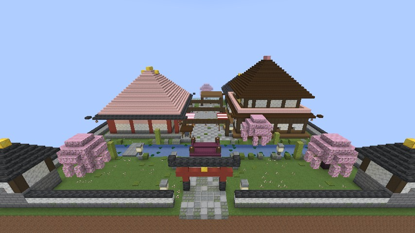
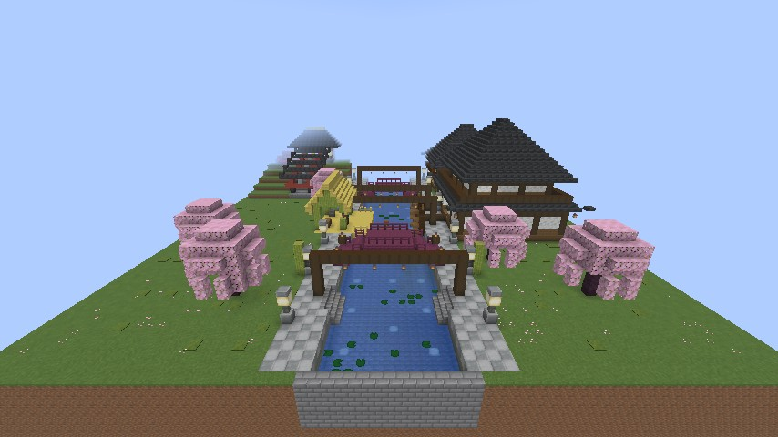
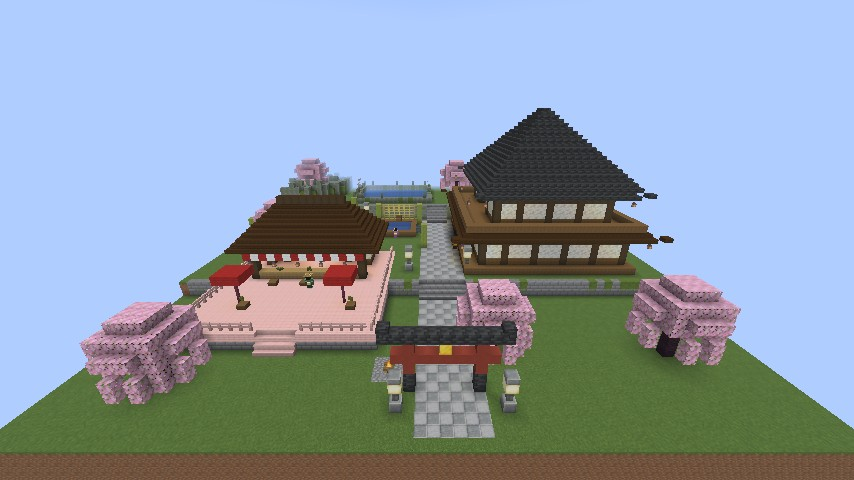
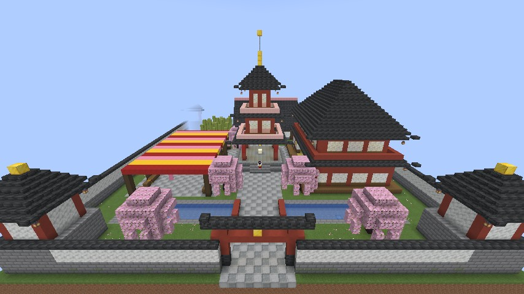

# Wild Places

Fourteen distinctive sites across the wild corners of the world, from the jungle, the Nether and the End to peaceful Japanese cherry-blossom settlements. Eight old ruins
guard a vault behind an **element rune seal**: open it with the matching rune magic. Vaults hold a breathing method manual page, runes of that place's elements, and Wildercord
materials: an Aura Shard, a Blank Rune, a Mana Crystal and a Spell Scroll. Each site also has a hall chest that anyone
can open, with Torn Pages among its finds. Two Emberwood Reach landmarks—the **Emberwood Charcoal Yard** and
the **Emberwood Kiln Court**—appear in warm border woodlands without a rune seal, while four peaceful **Sakura Villages** house kimono villagers and roaming Shrine Cats.

| Site | Where | Seal / Feature | Manual / Focus |
|---|---|---|---|
| Venom Ziggurat | Jungles | Life and Void | Venom |
| Dune Temple | Deserts | Earth and Wind | Dune |
| Rime Monastery | Snowy plains, snowy taiga, ice spikes, groves | Frost and Time | Rime |
| Iron Gatehouse | Badlands, [Emberwood Reach](emberwood-reach.md) | Earth and Storm | Iron |
| Dawn Pavilion | Cherry groves | Arcane and Life | Dawn |
| Echo Post | Deep dark floor | Wind and Void | Echo |
| Ember Outpost | Crimson and warped forests, Nether wastes | Fire and Blood | Ember |
| Void Lantern | End outer islands | Void and Arcane | Hollow |
| Emberwood Charcoal Yard | [Emberwood Reach](emberwood-reach.md), wooded badlands, forests | Kiln Keeper resident, Cinder Fern ash bed & kiln draft lamp | [Emberwood Reach](emberwood-reach.md) |
| Emberwood Kiln Court | [Emberwood Reach](emberwood-reach.md), wooded badlands | Optional [Kiln Widow](kiln-widow.md) heartstone challenge | [Kiln Widow](kiln-widow.md) |
| Sakura Village | Cherry groves, meadows, birch forests, forests | Peace compound, Tea House, Neko-Jinja, Kura, Zen garden, 4 residents & 4 Shrine Cats | Dawn |
| Sakura Canal Harbor | Cherry groves, rivers, flower forests, meadows, birch forests | Stone sea-lantern canal, twin crimson bridges, watermill, pier, 5-Torii hill shrine | Tide |
| Sakura Onsen Village | Cherry groves, meadows, groves, windswept hills, flower forests | Terraced Ryokan Inn, steaming Rotenburo hot springs, Ramen pavilion, Calligraphy gazebo | Dawn |
| Sakura Castle-Town | Cherry groves, plains, meadows, forests, birch forests | Shirakabe castle walls, Yagura towers, 3-tier Bell-Pagoda, Kendo Dojo & Forge, Market arcade | Iron |

## Venom Ziggurat

A stepped, mossy pyramid in the jungle. Climb the front stair to the shrine on top, where two Bogged with venom
spells keep watch. The way to the vault is the tunnel at the back. It has **tripwires** that fire poison darts
from both walls, so step over them or cut them. A witch with venom magic waits beside the seal.

## Dune Temple

A domed sandstone temple half buried in the dunes. Husks with mire spells walk the hall. In the middle of the floor
is a square of loose sand ringed in carved stone. **Dig one block** and the whole square drops into a hidden
sanctum below. A sandstorm adept guards the seal down there. Brush the suspicious sand in the hall and the
sanctum for small finds. A ladder in the sanctum's corner leads back up under a single block of sand.

## Rime Monastery

A broken monastery in the snow, with monks' cells, a frozen fountain, a chapel with its roof half fallen in and a
bell tower you can climb. No one guards it. The stair behind the chapel pews goes down to a crypt, and the seal is
in its wall.

## Iron Gatehouse

A ruined gate across an old road in the badlands and the Emberwood Reach. The portcullis is down. Skeletons with shackle spells hold the
rampart, reached by the ladder in the left tower (its iron door opens with the buttons beside it). The vault is
the right tower's strongroom, opened from inside the hall, and a vindicator adept stands inside it.

## Dawn Pavilion

A cherry wood pavilion with a stepped roof. A small white shrine always stands on its **east** side, facing the
sunrise, with a lamp that wakes with daylight. Nothing here fights you. Open the seal to reach the shrine's chest.

## Echo Post

A deepslate listening post on the deep dark floor, with wool floors, sculk sensors and amethyst. There are **no
shriekers**, and these posts never generate near ancient cities. Walk softly anyway. The records are behind the
seal at the back.

## Ember Outpost

A walled blackstone yard on a Nether cave floor, with a tower whose fire never goes out. Its wart blocks match the
forest around it. Wither skeletons with ember spells hold the yard, and the strongroom is the tower's ground floor.

## Void Lantern

A purpur tower on an End island, with a lit cage on the roof. Endermen with bolt, blind and pull spells live inside. Climb
the ladder to the second floor, open the seal into the alcove, and climb on to the lantern room at the top, where
the vault chest sits.

## Emberwood Charcoal Yard and Kiln Court

In the [Emberwood Reach](emberwood-reach.md), **Emberwood Charcoal Yards** keep a cooled
Cinder Fern ash bed, a kiln draft lamp and lever, *Eleven Winters at the Gate*, and a resident **Emberwood Kiln Keeper**.
Nearby **Emberwood Kiln Courts** hold the optional [Kiln Widow](kiln-widow.md) challenge.

## Sakura Villages (Four Archetypes)

Four distinct peaceful Japanese settlements generate in cherry groves and neighboring biomes, each populated by friendly kimono [Sakura Villagers](creatures.md#sakura-villagers) and roaming [Shrine Cats](creatures.md#shrine-cats), with two supply chests (`Dawn`, `Tide`, or `Iron` manual pages and shrine runes).

### Sakura Village

Sakura Village courtyard compound.

A white-plaster compound with twin South Yagura watchtowers, a Myojin Torii entrance, arched crimson Taiko-bashi drum bridge over a koi brook, two-story Tea House & Inn, **Neko-Jinja** Cat Shrine Pavilion (where **Freya** perches on her pink cushion dais), festival market stalls, Artisan Kura storehouse, open-air smithy, and Karesansui Zen rock garden.

### Sakura Canal Harbor

Sakura Canal & Lantern Harbor Village.

A water-front trading town built along a sunken stone sea-lantern canal spanned by twin arched crimson bridges and hanging lantern garlands. Features a two-story **Watermill & Tea Brewery** with a timber paddle wheel, a **Bamboo Dockhouse & Fishing Pier** with a moored wooden skiff, a glowing **Chochin Lantern Workshop**, and a stepped hillside path framed by five vermilion Torii gates climbing to an Inari Shrine.

### Sakura Onsen Village

Sakura Mountain Onsen Resort Village.

A three-tier terraced mountain hot-spring retreat housing a grand two-story **Wooden Ryokan Inn** with wrap-around balconies and blue *noren* curtains, steaming open-air **Rotenburo** rock pools and bamboo-screened cedar soaking tubs, a foreground **Ramen & Tea Pavilion** with red parasol umbrellas, and an upper cliffside **Calligraphy Gazebo**.

### Sakura Castle-Town

Sakura Feudal Castle-Town & Dojo Market Village.

A fortified *Shirakabe* walled castle-town with a front moat bridge, Ote-mon gatehouse, and three corner Yagura watchtowers surrounding a centerpiece **Three-Tier Village Bell-Pagoda** with a golden spire, a **Two-Story Kendo Dojo & Katana Swordsmith Forge** with a smoking stone blast chimney, a **Covered Lantern Market Arcade**, and a north **Herbalist & Apothecary Cottage**.

## Tips

- The vault walls are protected: you cannot dig around a seal in Survival.
- Each site has its own advancement, all under The Archive:

| Site | Advancement |
|---|---|
| Dawn Pavilion | First Light |
| Dune Temple | Shifting Sands |
| Echo Post | Listening In |
| Ember Outpost | Fire on the Tower |
| Emberwood Charcoal Yard | Keeper of the Charcoal Yard |
| Emberwood Kiln Court | The Cooled Kiln |
| Iron Gatehouse | The Last Gate |
| Rime Monastery | The Cold Bell |
| Sakura Village | Blossom Lanterns |
| Sakura Canal Harbor | Lantern Canals |
| Sakura Onsen Village | Steaming Blossoms |
| Sakura Castle-Town | Blossom Citadel |
| Venom Ziggurat | Poison Darts |
| Void Lantern | Light at the Edge |

The manual pages belong to these breathing methods: [Venom](../masters/venom.md),
[Dune](../masters/dune.md), [Rime](../masters/rime.md),
[Iron](../masters/iron.md), [Dawn](../masters/dawn.md),
[Echo](../masters/echo.md), [Ember](../masters/ember.md) and
[Hollow](../masters/hollow.md).
